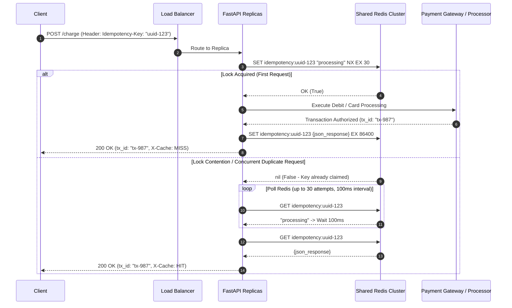
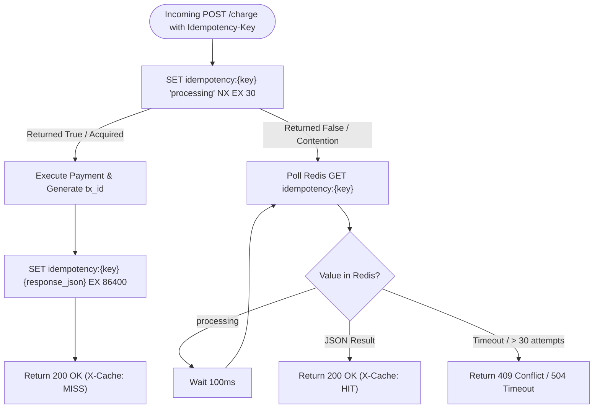

# Distributed Idempotency Keys for Payment APIs

A production-grade, distributed idempotency implementation for financial APIs using **FastAPI**, **Redis**, and the **`Idempotency-Key` header pattern**.

This project demonstrates how payment platforms (e.g., Stripe, Adyen, Square) guarantee **exactly-once execution semantics** under high concurrency, network dropouts, and automatic client retries.

---

## Architecture Overview



---

## Why Payment APIs Need Idempotency

### What is Idempotency?
An operation is **idempotent** if applying it multiple times produces the exact same side-effects and result as applying it once:
$$f(f(x)) = f(x)$$

In HTTP semantics, `GET`, `PUT`, and `DELETE` are inherently idempotent by specification. However, `POST` is **non-idempotent**: repeatedly posting `{amount: 100}` creates multiple distinct charges unless protected by an application-level idempotency protocol.

### The Naive Double-Charge Bug
Payment operations communicate over unreliable distributed networks across three actors: **Client**, **Merchant API Server**, and the **Payment Gateway / Banking Rail**:

```
[Client] --------(1) POST /charge--------> [Merchant API] --------(2) Debit $100--------> [Payment Gateway]
[Client]                                    [Merchant API] <-------(3) OK: Charged-------- [Payment Gateway]
[Client] <xxxxxxxx(4) Network Dropoutxxxxxx [Merchant API]
```

1. The client submits a payment.
2. The merchant server contacts the banking rail; **the customer's card is debited**.
3. The merchant server prepares HTTP 200.
4. **Network failure occurs before the response reaches the client** (or the client browser times out after 10 seconds).
5. The client or automated SDK retry logic triggers: *"The request timed out, let me resend the payment."*
6. **Without idempotency keys**, the merchant server treats the retry as a brand-new transaction and charges the card a second time!

---

## How the `Idempotency-Key` Header Works

1. **Client Generates Key**: The client (mobile app, frontend, or backend merchant SDK) generates a unique string (typically a UUID v4) before sending the request:
   ```http
   POST /charge HTTP/1.1
   Host: api.payments.com
   Content-Type: application/json
   Idempotency-Key: 9b1deb4d-3b7d-4bad-9bdd-2b0d7b3dcb6d

   {
     "amount": 99.99,
     "card_id": "card_tok_visa_1234"
   }
   ```
2. **Key Attachment to Intent**: That key represents the user's specific *intent* to perform that specific operation.
3. **Safe Retries**: If the network drops or returns a 5xx error, the client retries using the **exact same** `Idempotency-Key`. The server detects the key and returns the original response without executing another charge.

---

## The Race Condition Problem & How `SET NX` Solves It

### The Check-Then-Act Race
A naive implementation checks if the key exists before setting it:
```python
# VULNERABLE TO RACE CONDITIONS:
if not redis.exists(f"idempotency:{key}"):
    redis.set(f"idempotency:{key}", "processing")
    charge_credit_card()
```
If two identical requests arrive simultaneously (e.g. user rapid-clicks or twin network retries arrive within 5ms across two load-balanced servers):
1. Request A checks `redis.exists()` -> returns `False`.
2. Request B checks `redis.exists()` -> returns `False` (before A sets it).
3. Both proceed to charge the customer. **Double charge occurred!**

### The Solution: Atomic `SET key value NX EX`
Redis commands execute in a single-threaded event loop. We use the atomic `SET` command with options:
```text
SET idempotency:<key> "processing" NX EX 30
```
- **`NX` (Not eXists)**: Sets the key *only if it does not already exist*. Returns `OK` (or `True`) if created, or `nil` (or `None`) if the key was already present.
- **`EX 30`**: Sets a 30-second Time-To-Live. This acts as a lock safety lease: if the worker crashes or runs out of memory mid-transaction, the key automatically expires so the client is not blocked indefinitely.



---

## TTL Tradeoffs: Why 24 Hours, Not Forever?

In this implementation, completed transaction results are cached with:
```text
EX 86400 (24 Hours)
```

| Duration | Tradeoff Analysis |
| :--- | :--- |
| **Too Short (< 5 minutes)** | Clients on slow mobile networks or retry queues may resend the request after the key expired, causing a duplicate charge. |
| **24 Hours (Optimal)** | Covers 99.99% of transient network retries, automated job resubmissions, and daily batch processing windows. Keys naturally evict without filling Redis memory. |
| **Indefinite / Forever** | Incur huge memory overhead. As payment volume grows to millions of requests per day, Redis memory will exhaust or force premature LRU evictions. Furthermore, long-term state belongs in the durable relational database (PostgreSQL), not in-memory cache. |

---

## Architecture Comparison: Redis vs. Database Unique Constraints

| Architectural Dimension | Redis `SET NX` Claim Pattern | Database Unique Constraint (`UNIQUE(idempotency_key)`) |
| :--- | :--- | :--- |
| **Latency** | **Sub-millisecond** (0.2ms - 1ms in-memory). Fast path for API gateway. | **5ms - 50ms** (Disk I/O, table index locking, WAL flush). |
| **Database Connection Load** | Redis handles tens of thousands of concurrent locks without consuming DB connection pool slots. | Heavy concurrent retries can saturate Postgres/MySQL connection pool (`max_connections`). |
| **Long-term Durability** | In-memory with optional RDB/AOF. Best for in-flight synchronization and short-term replay. | ACID-compliant, persistent for years across audits. |
| **Rollback & Edge Cases** | Keys have native TTLs; crashed transactions auto-expire after 30s. | Requires dedicated reaper jobs or manual transaction status transitions (`PENDING`, `COMPLETED`, `FAILED`). |
| **Production Best Practice** | **Two-Tier Hybrid**: Redis acts as the high-speed distributed lock and immediate replay buffer (24h). The relational database stores the permanent record with a unique constraint. |

---

## Multi-Server Scalability Behind a Load Balancer

In modern cloud architectures, API servers are stateless and autoscaled behind a Load Balancer (AWS ALB, NGINX, Cloudflare).

```
                 +-------------------+
                 |   Load Balancer   |
                 +---------+---------+
                           |
            +--------------+--------------+
            |                             |
      +-----v-----+                 +-----v-----+
      | FastAPI-1 |                 | FastAPI-2 |
      +-----+-----+                 +-----+-----+
            |                             |
            +--------------+--------------+
                           |
                 +---------v---------+
                 |    Redis Node /   |
                 |  Sentinel Cluster |
                 +-------------------+
```

- Because **all FastAPI replicas share the same centralized Redis instance/cluster**, it does not matter which replica receives the initial request or subsequent retries.
- The atomic `SET NX` guarantee is evaluated at the Redis engine level, ensuring global consistency across any number of web instances.

---

## Project Structure

```text
idempotency-keys/
├── docker-compose.yml       # Orchestrates FastAPI service + Redis 7
├── test_idempotency.py      # Async test suite (concurrent & sequential verification)
├── README.md                # System design documentation & interview guide
└── app/
    ├── Dockerfile           # Python 3.11-slim container definition
    ├── requirements.txt     # fastapi, uvicorn, redis, httpx, pydantic
    └── main.py              # Core idempotency logic with SET NX EX & polling
```

---

## How to Run

### Method 1: Running with Docker Compose (Recommended)

1. Start both the FastAPI application and Redis:
   ```powershell
   docker-compose up --build -d
   ```
2. Check the logs:
   ```powershell
   docker-compose logs -f
   ```
3. Run the automated idempotency test suite:
   ```powershell
   python test_idempotency.py
   ```
4. Stop the services:
   ```powershell
   docker-compose down
   ```

### Method 2: Running Locally Without Docker

1. Ensure Redis is running locally on port `6379`:
   ```powershell
   redis-server
   ```
2. Navigate to `app` and install dependencies:
   ```powershell
   cd app
   pip install -r requirements.txt
   ```
3. Start the FastAPI server:
   ```powershell
   uvicorn main:app --host 0.0.0.0 --port 8000 --reload
   ```
4. In another terminal, run the test suite:
   ```powershell
   python test_idempotency.py
   ```

---

## Verification Test Output

Running `test_idempotency.py` tests four critical scenarios:
1. **Missing Key**: Asserts the server rejects requests without `Idempotency-Key` with HTTP 400.
2. **Concurrent Hammering**: Dispatches 5 concurrent requests with the **exact same** `Idempotency-Key` using `asyncio.gather`. Asserts that all 5 return HTTP 200 and produce the **exact same** `transaction_id`.
3. **Sequential Replay**: Re-submits the key after completion. Asserts instant cached response with `X-Cache: HIT`.
4. **Distinct Keys**: Submits a different key. Asserts a completely new, distinct `transaction_id` is generated.

Sample terminal output:
```text
==============================================================
       Payment API Idempotency Verification Test Suite        
==============================================================

Target API: http://localhost:8000

Test 1: Request without 'Idempotency-Key' Header
  [PASS] Server rejected missing idempotency key with HTTP 400.

Test 2: Firing 5 Concurrent Requests with SAME Idempotency-Key
  Idempotency-Key: order-idem-8c3b7a1e-588e-4a6c-9418-5a415ff5e01b
  -> Request #1: HTTP 200 | Transaction ID: a2c6d482-1d54-4638-b7eb-82806b026605 | Cache: MISS
  -> Request #2: HTTP 200 | Transaction ID: a2c6d482-1d54-4638-b7eb-82806b026605 | Cache: HIT
  -> Request #3: HTTP 200 | Transaction ID: a2c6d482-1d54-4638-b7eb-82806b026605 | Cache: HIT
  -> Request #4: HTTP 200 | Transaction ID: a2c6d482-1d54-4638-b7eb-82806b026605 | Cache: HIT
  -> Request #5: HTTP 200 | Transaction ID: a2c6d482-1d54-4638-b7eb-82806b026605 | Cache: HIT
  [PASS] All 5 requests returned HTTP 200 and identical Transaction ID: a2c6d482-1d54-4638-b7eb-82806b026605
         Exactly ONE payment charge was executed. Duplicate requests received idempotent cached replay.

Test 3: Sequential Replay with the same Idempotency-Key
  [PASS] Sequential replay returned original transaction ID instantly.
         X-Cache Header: HIT

Test 4: Request with a DIFFERENT Idempotency-Key
  Idempotency-Key: order-idem-49b2ef1b-69d8-4f51-b847-f3165243859f
  -> New Request: HTTP 200 | Transaction ID: b8e1b992-cf12-4217-a02b-980b18fa90ee
  [PASS] Different key generated distinct Transaction ID as expected: b8e1b992-cf12-4217-a02b-980b18fa90ee

--------------------------------------------------------------
>>> ALL IDEMPOTENCY TESTS PASSED! System guarantees exactly-once semantics. <<<
--------------------------------------------------------------
```

---

## Comprehensive Interview Questions & Answers

### 1. How would you make a payment API safe against duplicate requests?
> **Answer:**
> We implement the **Idempotency-Key header pattern**. The client generates a unique UUID for each logical operation and attaches it to the request header. 
> On the server side:
> 1. We execute an atomic claim step using Redis `SET idempotency:<key> "processing" NX EX 30`.
> 2. The first request that successfully claims the lock processes the transaction with the payment gateway, saves the resulting JSON response to Redis with a 24-hour TTL, and returns the response.
> 3. Any duplicate or concurrent requests arriving with the same key fail to acquire the lock; they wait/poll Redis and receive the exact cached response once complete.
> 4. Additionally, in our primary database, the `payments` table has a `UNIQUE(idempotency_key)` constraint as a defense-in-depth safety layer.

---

### 2. What is the difference between idempotency and retrying with exponential backoff?
> **Answer:**
> - **Exponential Backoff with Jitter** is a *client-side fault-tolerance policy* to avoid overwhelming a recovering server by spacing out retries exponentially (e.g. 1s, 2s, 4s, 8s).
> - **Idempotency** is a *server-side correctness contract*. Retrying with exponential backoff without idempotency is dangerous because each retry could trigger duplicate actions (double charges).
> - **They work together**: The client retries using exponential backoff, but *maintains the exact same Idempotency-Key* across every retry attempt so the server recognizes them as the same operation.

---

### 3. How do you handle two identical requests arriving at the exact same millisecond?
> **Answer:**
> This is a classic concurrency race condition. If two requests execute `GET` or `EXISTS` simultaneously, both will see that the key does not exist and both will proceed to charge.
> 
> We solve this using **atomic state transitions**:
> - We execute `SET key "processing" NX EX 30`. Because Redis commands are single-threaded and serialized, only one request will be processed first and return `OK` (`True`).
> - The second request is rejected (`nil` / `False`). Instead of charging, the second request enters a brief polling loop checking for the final result.
> - When the primary request finishes and overwrites the key with the final JSON result, the second request reads it and returns the cached response.

---

### 4. Why not just use the database's primary key / unique constraint instead of Redis?
> **Answer:**
> While a database unique constraint is great for persistent storage, using it as the *sole* concurrency and idempotency gate has significant operational drawbacks:
> 1. **Database Connection Saturation**: Concurrent retries will all hit the database, opening transactions, obtaining row/table locks, and exhausting the DB connection pool.
> 2. **In-Flight Lock Complexity**: A DB unique constraint only throws an error *after* a row is inserted. What happens while the first request is waiting for a 2-second external payment gateway response? To prevent the second request from charging, you would need to insert a `PENDING` record and manage distributed row locks in SQL, which is heavy and slow.
> 3. **Latency**: Redis operations complete in under 1 millisecond in memory, shielding the primary relational database from retry storms.
> 
> **Best Practice**: Use Redis as the high-throughput tier-1 lock and short-term replay cache (24 hours), and back it with a SQL `UNIQUE` constraint on the durable payment record.

---

### 5. Does this approach work across multiple servers behind a load balancer?
> **Answer:**
> Yes, perfectly. The FastAPI web application servers are completely **stateless**. They do not maintain any in-memory lock or local cache.
> 
> When a client retries or when concurrent requests are distributed by round-robin load balancing:
> - Request 1 goes to Server A. Server A acquires the lock in the shared Redis instance.
> - Request 2 goes to Server B. Server B checks the shared Redis instance, detects `"processing"`, and polls Redis until Server A writes the result.
> - Both servers access the exact same state in the centralized Redis cluster.

---

### 6. What happens if the API worker crashes mid-charge?
> **Answer:**
> This is addressed by the **30-second TTL (`EX 30`)** on the `"processing"` lock:
> 1. If an unhandled exception occurs inside our application, a `try...except` block explicitly deletes the key (`DEL idempotency:<key>`) so clients can immediately retry.
> 2. If the physical machine loses power or is killed (`SIGKILL`), the key automatically expires after 30 seconds due to the Redis TTL. This prevents the request key from being permanently locked ("stuck in processing").
> 3. In enterprise financial systems, before retrying an expired lock, the worker checks the payment gateway's status API using the merchant order ID to confirm whether the card was actually debited before releasing.

---

### 7. What if a client reuses an `Idempotency-Key` with a *different* request payload?
> **Answer:**
> In production payment systems (like Stripe), reusing an idempotency key with different parameters (e.g., trying to charge $500 using a key that previously charged $10) must be rejected to prevent fraud and bugs.
> 
> **How to implement Payload Fingerprinting**:
> Along with the status, we hash the request body (e.g. `SHA-256(amount + card_id)`). When an idempotency key is matched:
> - If the request payload hash matches the stored hash: return the cached response.
> - If the payload hash differs: return **HTTP 422 Unprocessable Entity** or **HTTP 400 Bad Request** with message: `"Idempotency key was previously used with different request parameters"`.
