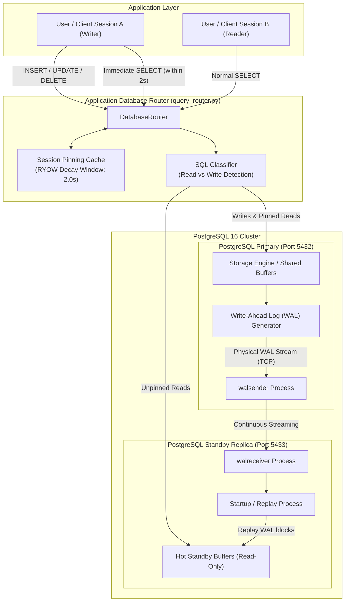
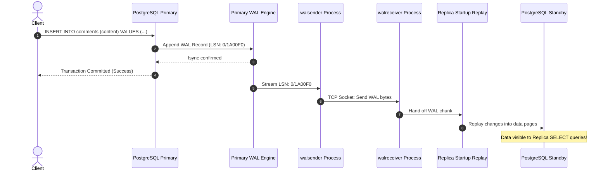
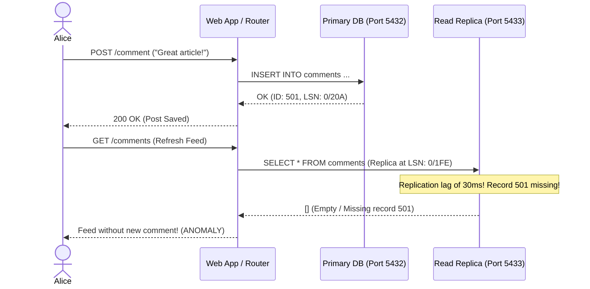

# PostgreSQL Primary-Replica Streaming Replication & Query Router

A production-grade simulation and architectural blueprint demonstrating **PostgreSQL 16 Physical Streaming Replication**, horizontal read scaling, replication lag measurement, and intelligent query routing with **Read-Your-Own-Writes (RYOW)** causal consistency.

---

## 1. Architecture Overview

In high-throughput transactional web services, read traffic typically outnumbers write traffic by an order of magnitude (e.g., 90% reads vs 10% writes). Placing all queries onto a single database server creates CPU, disk I/O, and lock contention bottlenecks.

This project deploys a primary-replica topology using Docker Compose, coupled with a Python-based intelligent `DatabaseRouter` that separates write concerns from read scaling while mitigating eventual consistency anomalies.



---

## 2. PostgreSQL Streaming Replication Under the Hood

### The Write-Ahead Log (WAL) Engine
PostgreSQL relies on the Write-Ahead Log to guarantee the **Atomicity and Durability** of transactions (ACID):
1. Any transaction that alters database state writes changes as a sequence of binary records to the WAL in memory.
2. Before the transaction commits, the WAL buffer is flushed to non-volatile disk storage (`fsync`). The actual database data pages (heaps and indexes) are modified in shared memory buffers and written asynchronously later via checkpoints.
3. Every WAL record is indexed by a 64-bit monotonically increasing integer called the **Log Sequence Number (LSN)** (e.g., `0/16E8B90`).

### Physical Streaming Replication Protocol
PostgreSQL streaming replication operates by streaming these raw WAL records across a network socket from the Primary to one or more Standby nodes:
- **Primary Side (`walsender`)**: When the standby connects, the primary forks a dedicated background worker called `walsender`. This process monitors newly generated WAL records and sends them across TCP to the replica.
- **Replica Side (`walreceiver`)**: The standby runs a `walreceiver` process that connects to the primary using standard PostgreSQL libpq replication protocols, receives incoming WAL chunks, and writes them to the replica's local `pg_wal` directory.
- **Replay Process (`startup`)**: A dedicated standby `startup` process continuously reads WAL segments from disk or directly from memory and applies the byte-level changes to the replica's data pages.
- **Hot Standby**: With `hot_standby = on`, PostgreSQL allows read-only client queries while the `startup` process continues applying incoming WAL records.



---

## 3. Physical vs Logical Replication

| Dimension | Physical Streaming Replication | Logical Replication |
| :--- | :--- | :--- |
| **Granularity** | Entire cluster (all databases, tables, schemas, catalogs) | Table-level or publication-level filtering |
| **Data Format** | Exact physical disk byte-blocks & WAL pages | Logical tuple changes (Row: INSERT/UPDATE/DELETE) |
| **PostgreSQL Versions** | Must match major version (e.g., PG 16 to PG 16) | Cross-version supported (e.g., PG 14 to PG 16) |
| **Operating System** | Architectures and collation must match | Cross-platform supported (e.g., Linux to ARM / Cloud) |
| **Standby Modifiability** | Strictly read-only (`hot_standby`) | Replicas can accept local writes and additional tables |
| **DDL Propagation** | Automatic (all `CREATE`, `ALTER`, `DROP` replicate) | Manual (DDL changes are NOT automatically replicated) |
| **Use Cases** | High Availability, DR, Read Scalability | Zero-downtime major upgrades, data warehousing, CDC |

---

## 4. Synchronous vs Asynchronous Replication Trade-offs

By default, PostgreSQL streaming replication is **asynchronous**. The primary writes WAL locally, signals commit success to the client, and transmits WAL to standbys in the background.

```
Asynchronous:
Client Write ──> [Primary WAL fsync] ──> Client ACK (Fast Latency, RPO > 0)
                          │
                          └──> [Network] ──> [Replica Replay]

Synchronous:
Client Write ──> [Primary WAL fsync]
                          │
                          └──> [Network] ──> [Replica Flush/Apply] ──> Client ACK (Higher Latency, RPO = 0)
```

### Durability vs Latency Spectrum (`synchronous_commit`):
1. `off`: Transaction commit returns before WAL is flushed to primary disk. Highest throughput, risk of data loss on sudden power outage.
2. `local` (Default Asynchronous): Commit returns as soon as WAL is flushed to local disk. High write throughput, but standby replication lag means failover can lose transactions (**RPO > 0**).
3. `remote_write`: Primary waits until standby acknowledges receiving WAL into OS buffer cache (not yet fsynced to disk).
4. `on`: Primary waits until standby flushes WAL to standby disk. Guarantees zero data loss (**RPO = 0**) if primary dies.
5. `remote_apply`: Primary waits until standby has physically applied the WAL change into shared buffers. Guarantees immediate read consistency on standby, but introduces highest write latency.

---

## 5. The Replication Lag & Eventual Consistency Problem

Under asynchronous replication, network jitter, disk saturation, or bulk write transactions on the primary create **Replication Lag**: the time delta between when a transaction commits on the primary and when it becomes visible on the replica.

### The Read-Your-Own-Writes Anomaly (The "Disappearing Post" Bug)
1. User Alice submits a new comment.
2. The web request routes the `INSERT` to the Primary. Primary commits.
3. The browser immediately redirects/refreshes the page to display the user feed.
4. The router dispatches the `SELECT` to the Read Replica.
5. Because the replica is lagging by 45ms, the new comment has not replayed yet!
6. **Bug**: Alice sees an empty feed. She thinks her post failed, so she clicks "Submit" again, creating duplicate data.



---

## 6. Solutions for Read-Your-Own-Writes (RYOW) Consistency

### Solution 1: Session Pinning / Time-decay Window (Implemented in `query_router.py`)
- When a client performs a mutating operation (`INSERT`, `UPDATE`, `DELETE`), the router records the timestamp in an in-memory or Redis-backed session map (`session_last_write[session_id] = now`).
- For subsequent read queries from that `session_id`, if `(now - last_write) < threshold` (e.g., 2.0 seconds), the read is pinned and routed directly to the **Primary**.
- Reads from all other passive sessions continue routing to the **Replica**.
- After the window elapses, the session's reads cleanly decay back to the Replica.

### Solution 2: Monotonic Causal Tokens / LSN Wait
- When the primary commits, it returns the committed transaction's LSN (`SELECT pg_current_wal_lsn();`).
- The application sends this token to the client (e.g., in an HTTP cookie or response header).
- On subsequent read requests, the client includes this token.
- Before querying the replica, the router checks `SELECT pg_last_wal_replay_lsn();`. If `replay_lsn >= client_token`, the replica is safe to query; otherwise, the router waits briefly or queries the primary.

### Solution 3: Explicit Mutation Overrides (`force_primary=True`)
- Critical read paths (such as billing confirmation, password changes, checkout totals) bypass replicas entirely by setting `force_primary=True`.

---

## 7. CAP Theorem Analysis During Network Partitions

In Eric Brewer's CAP theorem (Consistency, Availability, Partition Tolerance), distributed databases must choose between Consistency and Availability in the presence of a Network Partition ($P$):

```
                       [ Network Partition ]
                  Primary ◄───── X ─────► Replica
                     │                      │
           (Client A Writes)      (Client B Reads)
```

1. **Under Asynchronous Replication (AP - Availability & Partition Tolerance)**:
   - If the network between Primary and Standby is severed:
     - The **Primary continues accepting writes** (remains Available).
     - The **Replica continues serving reads** (remains Available).
     - **Cost**: The replica's data becomes increasingly stale over time ($C$ is sacrificed). Eventual consistency is maintained only after partition recovery.
2. **Under Synchronous Replication with Standby Quorum (CP - Consistency & Partition Tolerance)**:
   - If the replica becomes unreachable, the primary blocks write commits waiting for the standby acknowledgment (`synchronous_commit = on`).
   - Availability is sacrificed ($A$) to ensure that uncommitted or non-replicated data is never served.

---

## 8. Failover & Replica Promotion

When the primary hardware dies or crashes, a standby replica must be promoted to the new primary to restore write availability.

### Manual Promotion via PostgreSQL CLI
PostgreSQL standbys recognize promotion via the `pg_ctl` utility:
```bash
# Executed on the standby replica host
pg_ctl promote -D /var/lib/postgresql/data
```
**Under the hood**:
1. PostgreSQL removes `standby.signal` from the data directory.
2. The startup process completes replaying any buffered WAL logs.
3. PostgreSQL creates a new timeline branch in the WAL (e.g., timeline increments from 1 to 2) and opens the database for read-write transactions.

### Automated High-Availability: Patroni & Distributed Consensus
In production environments, manual failover is too slow and error-prone. Modern architectures use **Patroni** backed by a Distributed Consensus Store (DCS) like **etcd** or **Consul** (Raft protocol):

1. **Heartbeat Leader Key**: The primary node holds a dynamic lease key in etcd (TTL: 10s).
2. **Health Monitoring**: Each node runs a Patroni daemon checking PostgreSQL local health.
3. **Primary Loss**: If the primary crashes, the etcd lease expires.
4. **Leader Election**: The remaining standby nodes compare their replayed LSN. The standby with the most up-to-date WAL wins the election, acquires the leader lock, and automatically promotes itself.
5. **Fencing / STONITH**: The failed primary is forced offline to prevent Split-Brain.

---

## 9. Project Structure

```
d:\Portfolio\learning\system-design\postgres-read-replica\
├── docker-compose.yml       # Primary (5432) & Replica (5433) PostgreSQL 16 cluster
├── init-primary.sh          # Primary init: creates replicator user & sample tables
├── setup-replica.sh         # Replica init: runs pg_basebackup and enables hot standby
├── query_router.py          # DatabaseRouter with connection pools & RYOW session pinning
├── simulate_lag.py          # High-speed lag benchmark with ASCII real-time visualizer
├── test_router.py           # Unit & mock test suite covering routing, classification & RYOW
├── requirements.txt         # Python dependencies (psycopg2-binary)
└── README.md                # System design documentation & Senior Interview Q&A
```

---

## 10. Step-by-Step Execution Guide

### Step 1: Start the PostgreSQL Primary-Replica Cluster
Open PowerShell in this directory:
```powershell
docker compose up -d
```

Verify that both containers are running and the primary is healthy:
```powershell
docker compose ps
```

Inspect replication status on the Primary:
```powershell
docker exec -it postgres_primary psql -U postgres -c "SELECT client_addr, state, sent_lsn, write_lsn, flush_lsn, replay_lsn FROM pg_stat_replication;"
```

Verify that the replica is operating as a read-only standby:
```powershell
docker exec -it postgres_replica psql -U postgres -c "SELECT pg_is_in_recovery();"
# Should return 't' (true)
```

---

### Step 2: Install Python Dependencies & Run Tests
Install dependencies (in your virtualenv or system):
```powershell
pip install -r requirements.txt
```

Run the unit test suite:
```powershell
python -m unittest test_router.py -v
```

---

### Step 3: Run the Intelligent Query Router Demo
Execute `query_router.py` to see live session pinning and RYOW in action:
```powershell
python query_router.py
```

**Expected Output Behavior**:
- Queries without recent writes route to **REPLICA (Port 5433)**.
- Mutations (`INSERT`, `UPDATE`) route to **PRIMARY (Port 5432)**.
- Immediate subsequent reads from the mutating session route to **PRIMARY (Port 5432)** due to the 2.0s RYOW window.
- Other sessions continue querying **REPLICA**.
- After 2.2 seconds, the mutating session decays back to **REPLICA**.

---

### Step 4: Run the Replication Lag Benchmark
Run `simulate_lag.py` to blast the primary with writes and observe replication delay:
```powershell
python simulate_lag.py --records 1000 --batch-size 50
```

**Sample Output**:
```
================================================================================
 POSTGRESQL REPLICATION LAG BENCHMARK & REAL-TIME OBSERVER 
================================================================================
• Total Target Records : 1000
• Batch Size           : 50
• Write Target         : Primary (localhost:5432)
• Read Target          : Replica (localhost:5433)
• Poll Frequency       : Every 10ms
================================================================================

[PHASE 1] Rapidly inserting 1000 records into Primary...

[##############################] Primary: 1000/1000 | Replica: 1000/1000 | Lag:    0 rows | Time:  284.2ms

================================================================================
 REPLICATION LAG BENCHMARK REPORT
================================================================================
• Total Records Processed      : 1000
• Primary Write Time           : 242.15 ms
• Replica Catch-Up Latency     : 42.05 ms
• Total End-to-End Sync Time   : 284.20 ms
• Peak Row Count Disparity     : 148 rows
• Replication Stream State     : streaming
• Final WAL Replication Lag    : 0 bytes
================================================================================
```

---

## 11. Senior & Staff Engineer Interview Q&A

### Q1: How does PostgreSQL physical streaming replication work under the hood compared to logical replication? When should you choose one over the other?
**Answer**:
Physical streaming replication operates at the disk-block level by streaming exact binary Write-Ahead Log (WAL) records generated by the primary. The primary's `walsender` process pushes WAL bytes over a TCP socket to the replica's `walreceiver`, which writes them to disk, where the `startup` process replays them into PostgreSQL shared memory buffers.
- **Physical Replication Strengths**: Extremely low overhead, zero SQL re-parsing, guaranteed bit-for-bit parity, automatic replication of all DDL statements, schemas, indexes, and large objects.
- **Physical Replication Limitations**: All-or-nothing (cannot replicate individual tables), major PostgreSQL versions and CPU architectures must match, and the replica is strictly read-only.
- **Logical Replication**: Operates by decoding WAL records into logical row mutations (tuples: INSERT, UPDATE, DELETE) using a logical decoding plugin. It allows selective table replication, bi-directional replication, cross-version upgrades (e.g., PG 14 to PG 16), and writing additional data on the replica.
- **Decision Rule**: Choose **Physical Streaming Replication** for High Availability (HA), disaster recovery, and general read scalability. Choose **Logical Replication** for zero-downtime database upgrades, multi-tenant data federation, analytical CDC pipelines (e.g., Debezium into Kafka), or aggregating subsets of tables into a reporting warehouse.

---

### Q2: What causes replication lag in asynchronous replicas, and how do you monitor and alert on it in production?
**Answer**:
Replication lag is driven by three main bottlenecks:
1. **Network Latency & Bandwidth**: Saturated connections or high inter-region latency between primary and standby.
2. **Primary WAL Generation Rate**: Huge bulk operations (`UPDATE table SET status = 1;` affecting millions of rows) generate WAL faster than the network can transmit.
3. **Replica Replay Single-Threading**: On PostgreSQL, write transactions run concurrently across multiple CPU cores on the primary, but until recently the standby replay process operated largely sequentially on a single thread. If the replica suffers from slow disk I/O, it cannot replay blocks as fast as the primary generated them.
4. **Replication Conflicts**: Long-running analytical queries on the replica holding locks on tables being cleaned up by WAL vacuum on the primary.

**Monitoring & Alerting Strategy**:
- **On Primary**: Query `pg_stat_replication`:
  ```sql
  SELECT application_name, client_addr, state,
         pg_wal_lsn_diff(pg_current_wal_lsn(), replay_lsn) AS replay_lag_bytes,
         write_lag, flush_lag, replay_lag
  FROM pg_stat_replication;
  ```
- **On Replica**: Query `pg_last_xact_replay_timestamp()`:
  ```sql
  SELECT EXTRACT(EPOCH FROM (NOW() - pg_last_xact_replay_timestamp())) AS lag_seconds;
  ```
- **Production Alert Thresholds**:
  - *Warning*: Replay lag > 5 seconds or byte lag > 256MB for 3 consecutive check intervals.
  - *Critical*: Replay lag > 30 seconds or byte lag > 1GB (triggers removal of replica from application load balancer pool to prevent severe stale reads).

---

### Q3: How do you guarantee "Read-Your-Own-Writes" (RYOW) and "Monotonic Reads" consistency in a distributed primary-replica architecture without sending all traffic to the primary?
**Answer**:
Sending all reads to the primary defeats the purpose of horizontal read scaling. Instead, use one of three production strategies:

1. **Session-Level Time-Decay Pinning (Causal Consistency Window)**:
   - When a client issues a write mutation (`INSERT`/`UPDATE`), record a timestamp in the client's session state (e.g., in an HTTP-only cookie or distributed cache like Redis).
   - Any read query issued by that session within a configured threshold (e.g., $T = 2 \times \text{99th percentile lag} \approx 1-3\text{ seconds}$) is routed to the **Primary**.
   - After the window elapses, the session transitions back to reading from Replicas.
   - *Result*: The active author never sees stale data, while 90%+ of total traffic (passive readers) continues utilizing read replicas.
2. **LSN / Causal Token Checking**:
   - The primary returns the transaction's commit LSN to the application layer.
   - The client forwards this LSN token on subsequent requests.
   - The query router evaluates `pg_last_wal_replay_lsn()` on candidate read replicas. If a replica has already replayed past that LSN, it serves the request. If not, the router falls back to the primary or waits up to a 100ms timeout.
3. **Monotonic Reads (Session Stickiness)**:
   - Ensure a given user session is pinned to a *specific* replica (via consistent hashing on user ID). This prevents the "Time Travel" anomaly, where reading from replica A (lag = 10ms) followed by replica B (lag = 50ms) causes already-observed data to vanish.

---

### Q4: Explain the Split-Brain scenario during failover. How do high-availability orchestrators like Patroni prevent two nodes from acting as primary simultaneously?
**Answer**:
A **Split-Brain** occurs when a network partition isolates the Primary from its Standbys:
1. The standbys lose communication with the primary, assume it has died, and promote one standby to be the new primary.
2. If the old primary is still alive and accepting writes from a subset of clients, both nodes diverge in their WAL timelines.
3. Because both nodes accept writes independently, the data sets permanently diverge, resulting in severe data corruption and impossible reconciliation.

**How Orchestrators (Patroni / Raft / etcd) Prevent Split-Brain**:
1. **Leader Key Lease with TTL**: The active primary must continuously renew a heartbeat lease in a Distributed Consensus Store (DCS, e.g., etcd or Consul) every few seconds.
2. **Quorum Requirement**: The DCS itself relies on majority quorum ($N/2 + 1$). In a partition, only the partition containing the majority of nodes can elect or maintain a leader.
3. **Automatic Demotion**: If the primary fails to renew its etcd lease within the TTL (due to a network isolate or process hang), the local Patroni daemon immediately forces the old PostgreSQL instance into read-only mode or shuts it down.
4. **Fencing / STONITH ("Shoot The Other Node In The Head")**: In enterprise environments, hardware fencing agents, cloud API calls (e.g., detaching EBS volumes), or watchdog timers forcefully terminate the power or network of the old primary before the candidate replica executes `pg_ctl promote`.

---

### Q5: What happens to long-running analytical queries on a read replica when the primary applies WAL cleanup or vacuuming (Replication Conflicts)? How do you mitigate this?
**Answer**:
On the primary, VACUUM deletes dead tuples (rows no longer visible to active transactions) and cleans up table blocks. When these cleanup operations are recorded in the WAL and streamed to the replica:
- If a long-running `SELECT` query on the replica is currently reading from those exact table pages or holds an AccessShareLock, replaying the WAL would delete data out from underneath the active query!
- This condition is called a **Replication Conflict**.

PostgreSQL's default behavior is controlled by `max_standby_streaming_delay` (default: 30 seconds):
1. The replica pauses WAL replay and waits for the analytical query to finish.
2. If the query does not complete within `max_standby_streaming_delay`, PostgreSQL **cancels the client query** and throws the error:
   `ERROR: canceling statement due to conflict with recovery`
   `DETAIL: User query might have needed to see row versions that must be removed.`

**Mitigation Strategies**:
1. **Increase `max_standby_streaming_delay`**: Set to `15min` on dedicated analytical replicas. Note: this will cause the replica's replication lag to spike during long queries.
2. **Enable `hot_standby_feedback = on`**: The replica informs the primary about the oldest transaction ID (`xmin`) currently running on the standby. The primary's VACUUM will delay removing dead tuples until the replica's query completes.
   - *Trade-off*: Prevents query cancellations, but causes table bloat on the primary if queries on the replica run for hours.
3. **Segregate OLTP and OLAP Replicas**: Maintain distinct replicas: one for low-latency web reads (`hot_standby_feedback = off`, low delay) and another isolated replica for data science/ETL queries with `hot_standby_feedback = on`.
